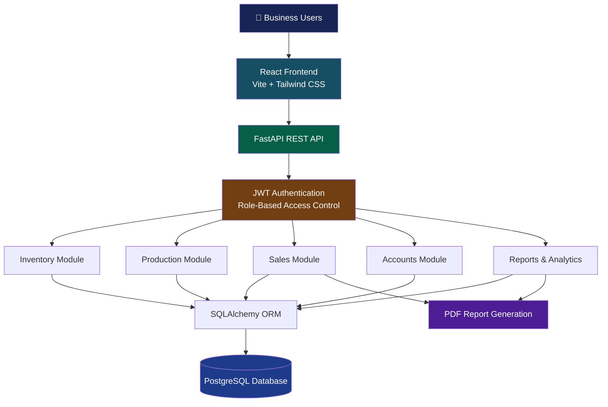
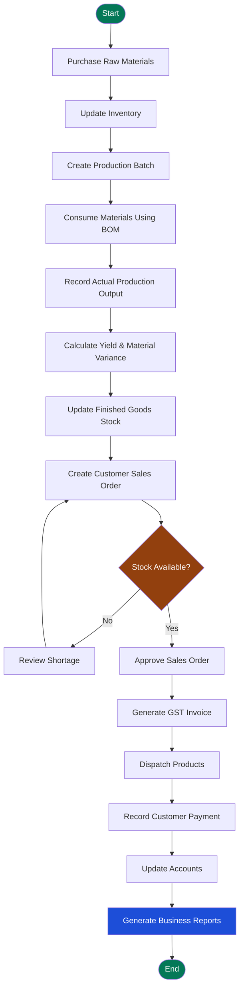
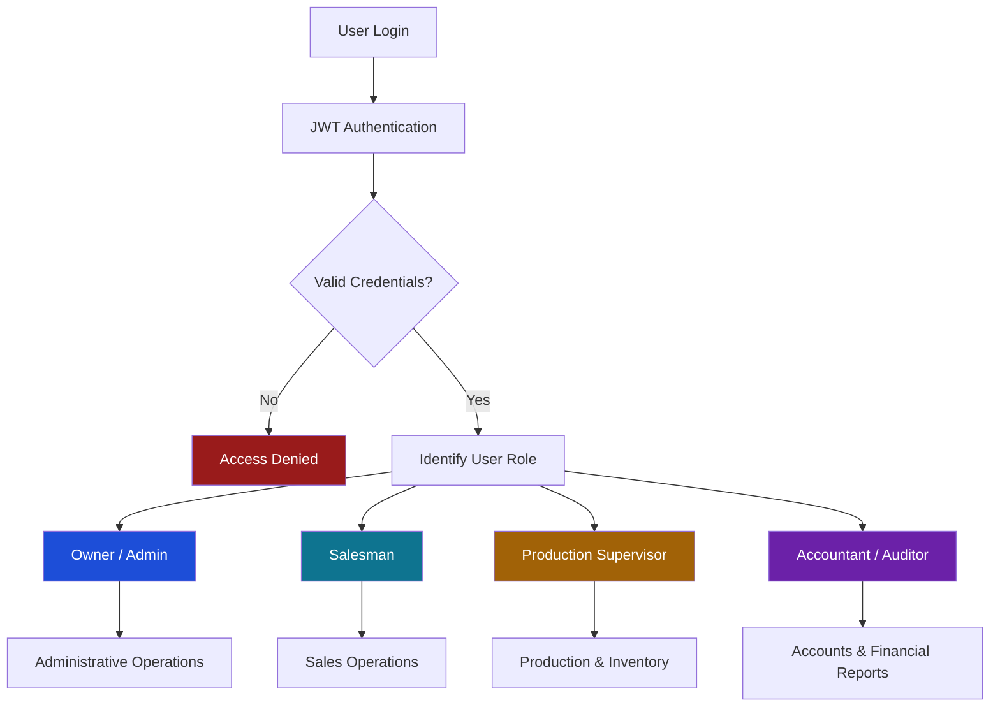

# ✨ OrderToAudit

<p align="center">
  
</p>

<p align="center">
  <b>An Integrated Manufacturing Business Management Platform</b>
</p>

<p align="center">
  
  
  
  
</p>

<p align="center">
  
  
  
</p>

---

## 🚀 About the Project

**OrderToAudit** is a centralized manufacturing management system that connects inventory, production, sales, invoicing, payments, and financial reporting in one application.

Designed around the workflow of small and medium-scale manufacturers, it helps businesses monitor operations, track material consumption, calculate production variance, manage customer orders, and maintain transaction records.

The main objective is simple:

> **Every transaction should be traceable, every stock movement should be accountable, and every business operation should be connected.**

---

## ⚡ Core Modules

<table>
<tr>
<td width="50%">

### 📦 Inventory Management
- Raw material tracking
- Packaging material tracking
- Finished goods monitoring
- Purchase recording
- Stock adjustments
- Transaction-based stock ledger

</td>
<td width="50%">

### 🏭 Production Management
- Production batch creation
- Bill of Materials (BOM)
- Material consumption tracking
- Actual vs planned output
- Damaged goods recording
- Yield and material variance

</td>
</tr>
<tr>
<td width="50%">

### 🛒 Sales Management
- Customer management
- Sales order creation
- Stock availability validation
- Order approval
- Dispatch tracking

</td>
<td width="50%">

### 🧾 Invoice Management
- GST invoice generation
- Tax calculations
- PDF invoice downloads
- Invoice status tracking
- Outstanding balance calculation

</td>
</tr>
<tr>
<td width="50%">

### 💰 Accounts Management
- Customer payment recording
- Payment history
- Outstanding balance tracking
- Expense management

</td>
<td width="50%">

### 📊 Reports & Analytics
- Inventory reports
- Production reports
- Material variance analysis
- Financial summaries
- GST summaries
- Business performance PDF

</td>
</tr>
</table>

---

## 🏗️ System Architecture



---

## 🔄 End-to-End Business Workflow

The system connects the complete manufacturing lifecycle.



---

## 🔐 Role-Based Access Control

Different users have access to different business operations.



---

## 🧰 Technology Stack

| Layer | Technology |
|---|---|
| Frontend | React |
| Build Tool | Vite |
| Styling | Tailwind CSS |
| Backend | Python, FastAPI |
| Database | PostgreSQL |
| ORM | SQLAlchemy |
| Authentication | JWT |
| Password Hashing | Argon2 |
| PDF Generation | ReportLab |
| Testing | Pytest |
| Version Control | Git, GitHub |

---

## 📂 Project Structure

```text
OrderToAudit/
│
├── backend/
│   ├── tests/
│   │   └── test_api.py
│   │
│   ├── main.py
│   ├── models.py
│   ├── database.py
│   ├── auth.py
│   │
│   ├── init_db.py
│   ├── seed_data.py
│   │
│   ├── add_bom.py
│   ├── add_customers.py
│   ├── add_materials.py
│   ├── add_product.py
│   │
│   ├── record_purchase.py
│   ├── record_production.py
│   ├── approve_and_invoice.py
│   ├── dispatch_order.py
│   ├── record_payment.py
│   ├── record_expenses.py
│   │
│   └── ...other modules
│
├── frontend/
│   ├── public/
│   ├── src/
│   │   ├── Accounts.jsx
│   │   ├── Inventory.jsx
│   │   ├── Invoices.jsx
│   │   ├── Login.jsx
│   │   ├── Production.jsx
│   │   ├── Reports.jsx
│   │   ├── SalesOrders.jsx
│   │   ├── App.jsx
│   │   └── main.jsx
│   │
│   ├── package.json
│   └── vite.config.js
│
├── .gitignore
└── README.md
```

---

## ⚙️ Installation & Setup

### 1. Clone the repository

```bash
git clone https://github.com/nk-00-01/OrderToAudit.git
cd OrderToAudit
```

### 2. Backend setup

```powershell
cd backend
python -m venv venv
.\venv\Scripts\Activate.ps1
```

Install dependencies:

```powershell
pip install fastapi uvicorn sqlalchemy "psycopg[binary]" python-dotenv "pwdlib[argon2]" PyJWT python-multipart reportlab pytest httpx
```

### 3. Configure environment variables

Create `backend/.env`:

```env
SECRET_KEY=your_generated_random_secret
```

Configure the PostgreSQL connection using the exact environment variable names expected by `backend/database.py`.

Never commit `.env` or expose database credentials.

### 4. Create the database

Create a PostgreSQL database:

```sql
CREATE DATABASE order_to_audit;
```

Initialize the database:

```powershell
python init_db.py
```

Load demonstration data using the required setup and seed scripts.

### 5. Start the backend

```powershell
python -m uvicorn main:app --reload
```

Backend: `http://127.0.0.1:8000`

API Documentation: `http://127.0.0.1:8000/docs`

### 6. Start the frontend

Open a second terminal:

```powershell
cd frontend
npm install
npm run dev
```

Frontend: `http://localhost:5173`

---

## 🧪 Testing & Build

### Backend tests

```powershell
cd backend
python -m pytest -W default
```

**Latest test result:**

```text
12 passed, 1 warning
```

The warning is a Starlette TestClient/httpx deprecation notice.

### Frontend production build

```powershell
cd frontend
npm run build
```

Production output is generated in `frontend/dist`.

---

## 🛡️ Security & Data Integrity

- JWT-based authentication
- Password hashing
- Role-based API permissions
- Stock availability validation
- Negative stock prevention
- Payment validation
- Transaction-based inventory ledger
- Environment-based secret management

*GST configuration and invoice calculations must be verified against actual business registration and applicable tax requirements before real-world use.*

---

## 📈 Future Enhancements

- [ ] Advanced dashboard analytics
- [ ] Excel report exports
- [ ] Email notifications
- [ ] Cloud deployment
- [ ] More comprehensive automated tests
- [ ] Advanced audit logs
- [ ] Configurable business settings

---

## 👨‍💻 Author

**OrderToAudit** — Full-stack manufacturing management project.

GitHub: [@nk-00-01](https://github.com/nk-00-01)

Repository: [OrderToAudit](https://github.com/nk-00-01/OrderToAudit)

---

<p align="center">
  
  <br/>
  <b>OrderToAudit</b><br/>
  <i>One Platform. Every Transaction. Complete Visibility.</i>
</p>
